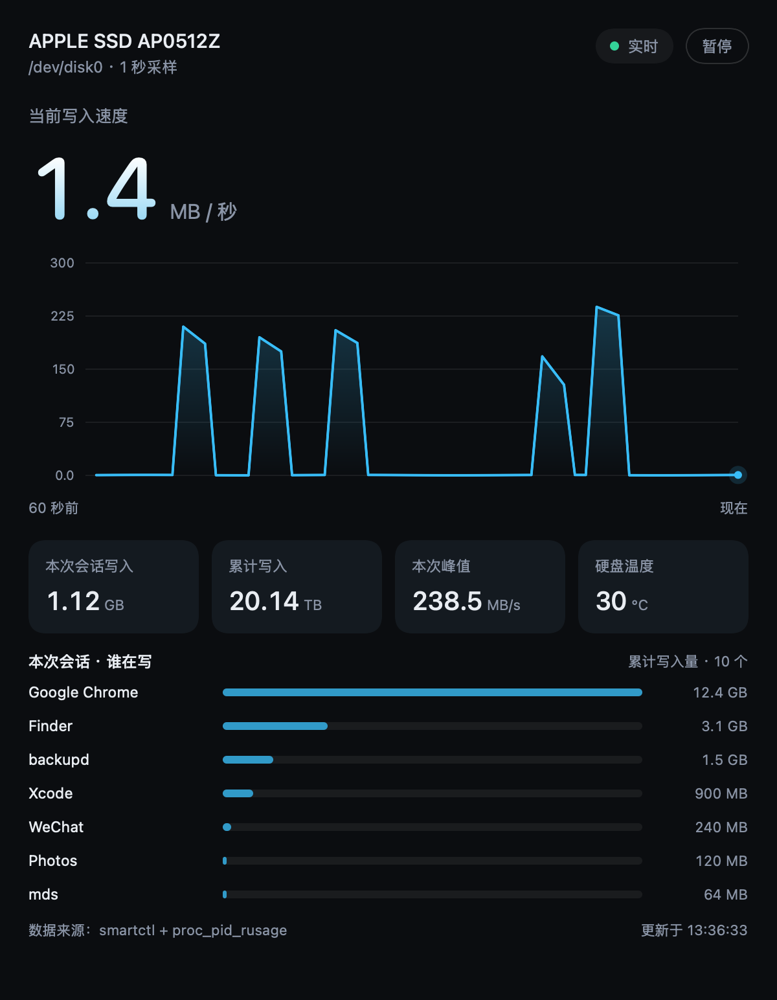

# 磁盘写入量 · macOS 小工具

一个原生 macOS 小窗口，实时显示硬盘写入速度，并列出各个进程累计写了多少。
不需要浏览器、不需要终端，内置 `smartctl`，下载即用。



## 功能

- 当前写入速度（MB/s）与最近 60 秒曲线
- 本次会话累计写入、峰值、硬盘温度
- 「谁在写」排行：按进程累计写入量排序，列表可滚动查看全部
- 只读监控，不联网、不上传任何数据

## 下载

前往 [Releases](../../releases) 下载最新的 `.dmg`，双击打开，
把「磁盘写入量」拖进「应用程序」。

首次打开如果提示「无法验证开发者」，在图标上右键 →「打开」→ 再点一次「打开」。
实在不行可以执行：

```bash
xattr -dr com.apple.quarantine "/Applications/磁盘写入量.app"
```

系统要求：macOS 13 及以上，Apple Silicon / Intel 均可。

## 从源码构建

```bash
cd disk-write-app-v2
./build.sh
```

需要命令行工具：`xcode-select --install`。脚本会编译 arm64 + x86_64、
合并通用二进制、内置 smartctl、做临时签名，并尝试生成 dmg。

## 目录

| 路径 | 说明 |
| --- | --- |
| `disk-write-app-v2/` | 当前版本（进程级累计） |
| `disk-write-app/` | v1，仅整盘写入量 |
| `disk-write-dashboard/` | 早期的本地网页面板 |
| `smart-write-monitor.sh` | 最早的终端版脚本 |

各目录内有更详细的 README，版本留档见 `disk-write-app-v2/archive/README.md`。

## 数据是怎么来的

| 指标 | 来源 |
| --- | --- |
| 写入速度 / 累计写入 | `smartctl` 的 `Data Units Written`（落盘量） |
| 各进程写入量 | `proc_pid_rusage`（系统写请求量） |

两者不会完全相等：中间隔着文件系统缓存、APFS 压缩和快照。

## 已知限制

- 只活几百毫秒的进程可能来不及被采样，不会出现在排行里。
- `kernel_task` 等系统进程可能读不到计数，所以进程之和通常小于盘级写入量。
- 排行是「本次打开 App 以来」的累计，重启应用后归零。
- 未做开发者签名与公证，跨机器分发需要右键打开。

## 许可证

[GPL-2.0](LICENSE)。内置的 smartctl 来自 smartmontools，同样是 GPLv2，
详情见 [THIRD_PARTY_NOTICES.md](THIRD_PARTY_NOTICES.md)。
